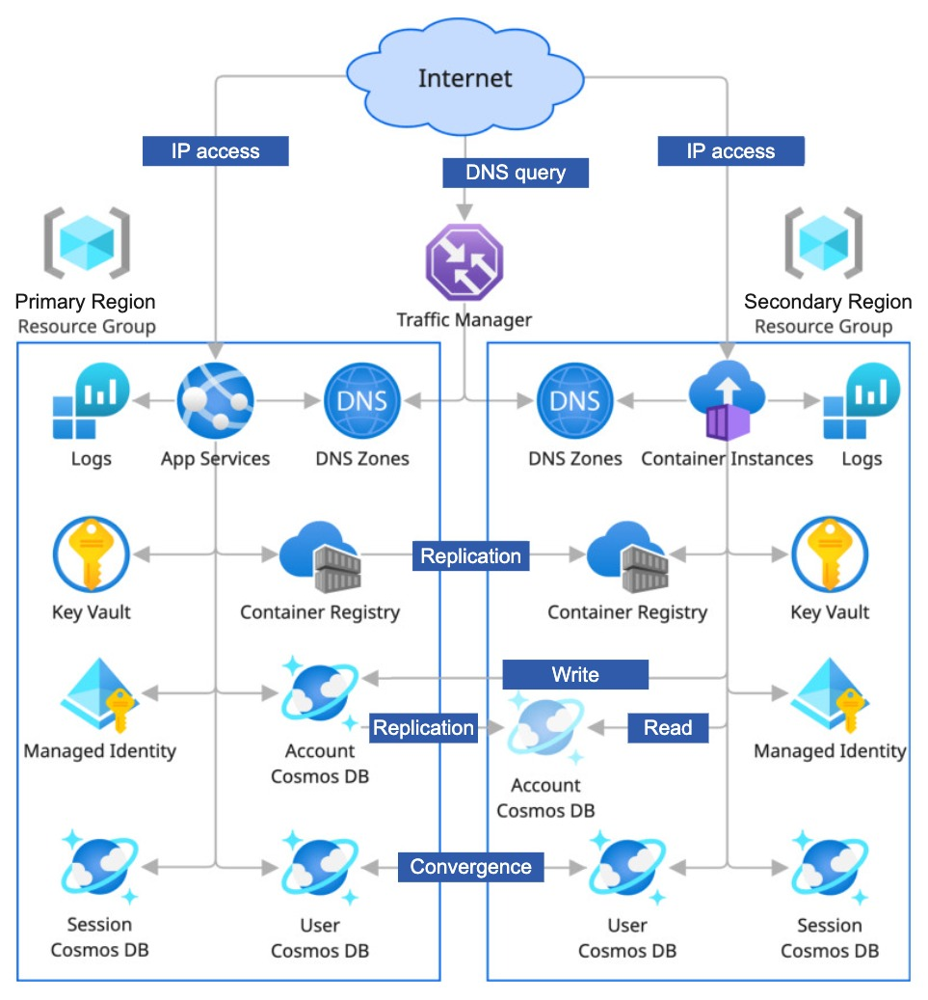

# Exploring Azure multi-region resilience

## Overview

Running in several regions can bring the application closer to its users and reduce its dependency on one location. However, deploying more servers is only part of the work. Data must be available where it is needed. Changes made separately must reach a common state, and interrupted operations need a way to recover. Routing and deployment also need to work across the whole environment.

This is a prototype that uses Cosmos DB, containers in each region, replicated container images and DNS routing to explore the balance between data consistency, availability and response time through a small social application.

**This repository is a scratchpad for research and experimentation.** It is not production code or a complete guide to globally distributed applications.

## The prototype

### The Azure infrastructure

[The infrastructure guide](./infrastructure/README.md) explains how the Azure services form one environment. Terraform, an infrastructure configuration tool, creates the regional resources and their connections. The important distinction is between services that replicate data and services that need a separate deployment in each region.

### The ASPNetCore service

[SocialApp](./src/README.md) provides practical examples of the problems: reserving a unique email address, updating two users' follow lists, copying conversations into feeds and maintaining counters through the assigned regional processor.

## The Design

### Data Stores

- **Account**
  - One write region, read-only copies in the other regions and Consistent Prefix consistency. Service-managed failover can change the write region.
  - Email and handle reservations need one place for deciding whether a value is already taken. A stale read cannot grant a reservation; the final write decides.
- **Session**
  - A separate serverless account and database in each region, with Consistent Prefix and no cross-region replication.
  - Stores login sessions, user details and database session tokens with a time to live (TTL).
  - It is accepted that switching region requires login again.

- **User**
  - Multiple write regions and Session consistency allow requests to use nearby database replicas. Copies in other regions can be behind.
  - The Profile container holds profiles, credentials, handle mappings and follow lists. The Contents container holds source content, reaction intent, view events and conversation counters. The Feed container holds copies for followers.
  - Contents uses custom conflict resolution. Profile and Feed use the default last-writer-wins policy.
  - Source writes can arrive from any region, but only the assigned content processor maintains counters and related copies. Likes, comments and views use integer totals, not separate regional contributions.

### Cross-partition transactions

The application uses **fan-out**: content is copied into followers' partitions so their feeds can be read without querying every author. These copies cannot be saved in one transaction, because Cosmos DB transactions cover only one partition key within one container.

  - User actions like publishing, commenting, reacting and deleting are first saved in the user's own partition in the Contents container. The request does not update followers' partitions.
  - The root conversation sets its `ProcessingRegion`, which acts as a **shard leader** for that conversation. Comments, nested replies, reactions and related copies inherit this owner.
  - The content processor reads the **change stream**, applies the action to the conversation and updates its counters. It then copies the resulting content and counters to followers' partitions.
  - Saved progress allows processing to continue after an interruption. Local transactions record what has already been applied, so a retry does not count the same action twice. Copies can remain behind until processing catches up.
  - Writes accepted in different regions can produce conflicting versions. A **custom conflict resolution policy** allows the processing region to decide which is the final document.
  - Only processors assigned to that region handle those documents in the change and **conflict streams**. Other regions can accept user actions, but do not independently propagate or count them. This avoids competing regional processors applying the same action.
  - The document processing region selects this responsibility independently of the stack's deployment location. A stack hosted elsewhere can cover the same processing region, provided takeover stops the previous processors and lets their committed writes replicate first.

## Challenges 

### Transactions across partitions

A Cosmos DB transaction covers one logical partition within one container. Changes outside that boundary can stop after only some writes succeed. The prototype groups related documents where possible and records enough information to complete or clean up interrupted work.

Registration uses a pending record, follow relationships use pending states, and content changes use asynchronous processing. These approaches allow recovery, but related documents can disagree while the unfinished work is being handled.

### Concurrent writes and delayed copies

Several write regions can accept changes before seeing each other's updates. The application therefore needs rules for competing versions of the same document. Selecting one message version can be acceptable, while selecting just one counter total can lose increments from another region.

The prototype keeps message content separate from counters. Requests save source intent; only the processor assigned to the root conversation's processing region maintains integer counters and related copies. Recording the applied state together with the counter change prevents retries from counting it twice. The conflict processor uses the same regional assignment and selects the later mutable creation date.

The change feed carries updates from the user's source partition to the conversation and then to followers' feeds. These are separate local transactions, so related copies can differ until processing catches up.

### Regional failures

One global DNS name lets clients reach a regional API. Geographic routing chooses the preferred region, and nested priority routing provides another endpoint when that API becomes unhealthy.

API routing, database failover and background worker recovery are separate processes. A client reaching another API does not prove that Account writes have recovered or that all feed updates have been processed. Replicated checkpoints support worker recovery. Both content and conflict processors can cover another region through the processing-region setting, independently of where they run. Controlled takeover requires stopping the previous processors and allowing their committed writes to replicate before starting replacements.

The design also accepts that recent writes may not have reached another region before an outage. Recovery needs to consider both the time before operations work again and the changes that might have been lost. These are commonly called the recovery time objective (RTO) and recovery point objective (RPO). Their relationship with Cosmos DB replication is described in [Microsoft's reliability guide](https://learn.microsoft.com/en-us/azure/reliability/reliability-cosmos-db).

### Deployment across regions

Container images are published, copied between regions and then selected for deployment. Copying an image does not update a running application. Compatible versions can run together during deployment. The integer-counter change requires fresh data and no overlap with the previous processors; the prototype has no migration from regional counter maps.

The experiment uses Container Apps in East US 2 and Container Instances in West US 2 because of student subscription restrictions. Container Apps was the preferred option for a real application because it supports autoscaling and gradual deployments. Container Instances provides simpler hosting for the experiment.

## Research questions

- Which Azure services support a global application?
  - Which services replicate their data, and which need a separate setup in each region?
- Which operations can accept writes in several regions?
  - How do conflicting versions reach the same state without losing required changes?
- Which operations can continue during a regional failure?
  - Which still depend on one write region, a regional session or a background worker?
- How can incomplete operations recover?
  - What happens if processing repeats or stops for a long time, and how long must recovery records remain stored?
- How does deployment work across regions?
  - How can different application versions safely share the same data during an update?

## Conclusions

Azure provides the services needed to distribute an application, but replication does not remove the need for application-level recovery. Transaction boundaries, conflicting writes and delayed copies still influence the data model and the behaviour visible to users.

Different data needs different guarantees. A single write region simplifies global uniqueness. Multiple write regions improve local access but require conflict rules. Regional sessions simplify storage but make switching regions visible to users. Background processing reduces the work done during a request, while adding dependencies and a delay before copies catch up.

The prototype makes these trade-offs visible through concrete operations. Its remaining limits are part of the result: a healthy API is only one part of recovery, saved progress does not arrange regional worker takeover by itself, and compatible data formats are necessary while regions run different versions.
